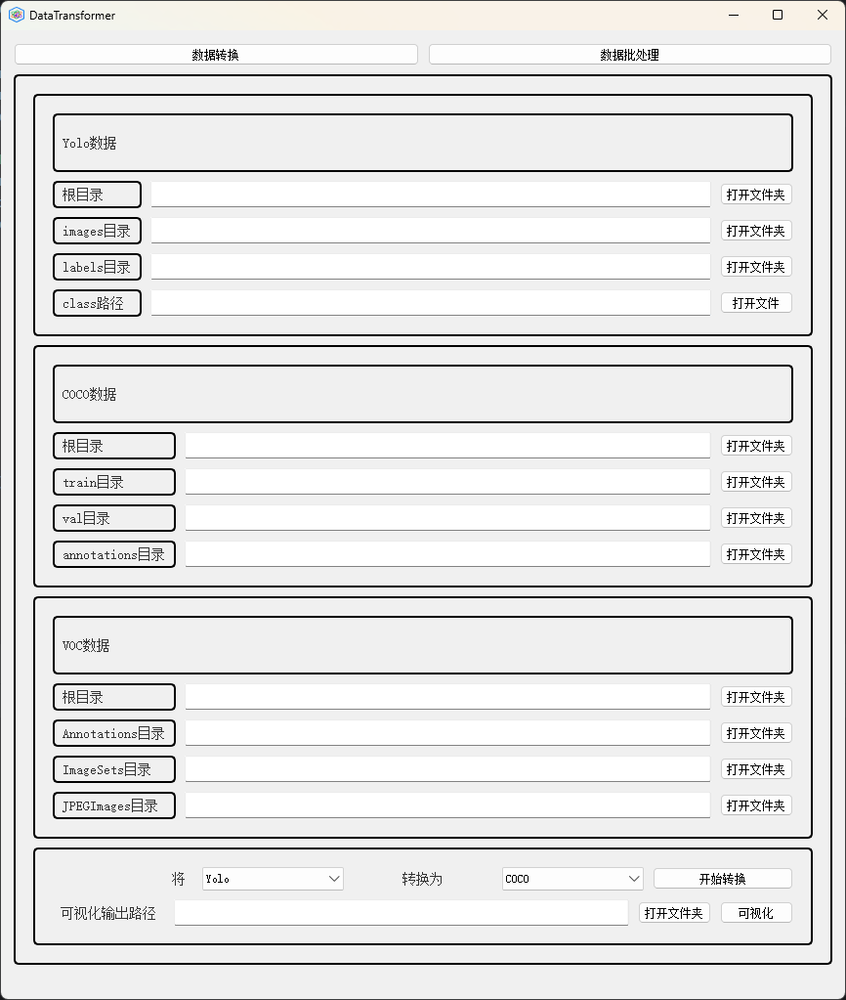
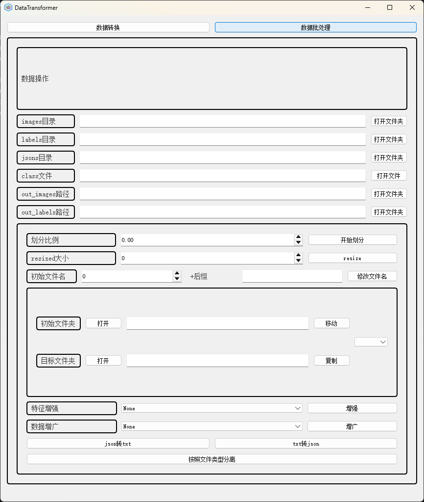

# Data Transformer 使用说明 

## 1. 软件概述 

Data Transformer 是一个基于 PyQt5 开发的图形界面工具，主要用于处理计算机视觉领域的数据集格式转换和批量操作。该工具支持 YOLO、COCO 和 VOC 三种主流数据集格式之间的相互转换，同时提供丰富的批量处理功能。

## 2. 主要功能

### 2.1 数据集格式转换
- 支持 YOLO ↔ COCO ↔ VOC 三种格式之间的相互转换
- 提供可视化功能，可预览转换结果

### 2.2 批量处理功能 
- 数据集分割：按比例分割数据集
- 图像重设大小：批量调整图像尺寸
- 文件重命名：自定义命名规则批量重命名
- 文件移动/复制：批量操作文件
- 格式转换：JSON ↔ TXT 格式互转
- 特征增强：提供多种图像增强选项
- 数据增广：支持多种数据增广方式

## 3. 界面说明

### 3.1 主界面布局 
软件采用分页式设计，包含两个主要页面：
1. 数据转换页面：处理不同格式间的转换
)
2. 批量处理页面：提供各种批量操作功能
)

### 3.2 控件说明
- 路径选择：通过"浏览"按钮选择文件/文件夹路径
- 组合框：选择转换源格式和目标格式
- 数值输入：设置分割比例、图像尺寸等参数
- 操作按钮：执行相应功能

## 4. 使用步骤 

### 4.1 格式转换
1. 在"数据转换"页面选择源格式和目标格式
2. 设置相应格式的路径参数
3. 点击"转换"按钮执行转换
4. (可选)设置输出路径并点击"可视化"预览结果

### 4.2 批量处理 
1. 切换到"批量处理"页面
2. 根据需求选择功能：
   - 分割数据集：设置输入路径、输出路径和分割比例
   - 重设大小：指定目标尺寸和输入输出路径
   - 重命名：设置起始编号和名称规则
   - 移动/复制：设置源文件夹和目标文件夹
3. 点击相应功能按钮执行操作

## 5. 注意事项 

1. 进行格式转换前，请确保已正确设置所有必需的路径参数
2. 批量操作前建议先备份原始数据[[2]()]
3. 图像处理功能可能需要较长时间，请耐心等待

## 6. 开发信息 

- 开发语言：Python 
- GUI框架：PyQt5
- 兼容格式：YOLO、COCO、VOC 

如需更详细的技术实现，请参考源代码中的注释